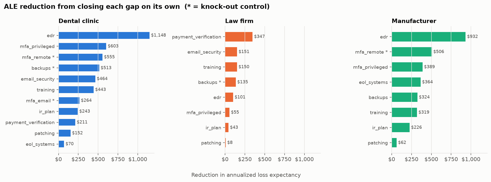
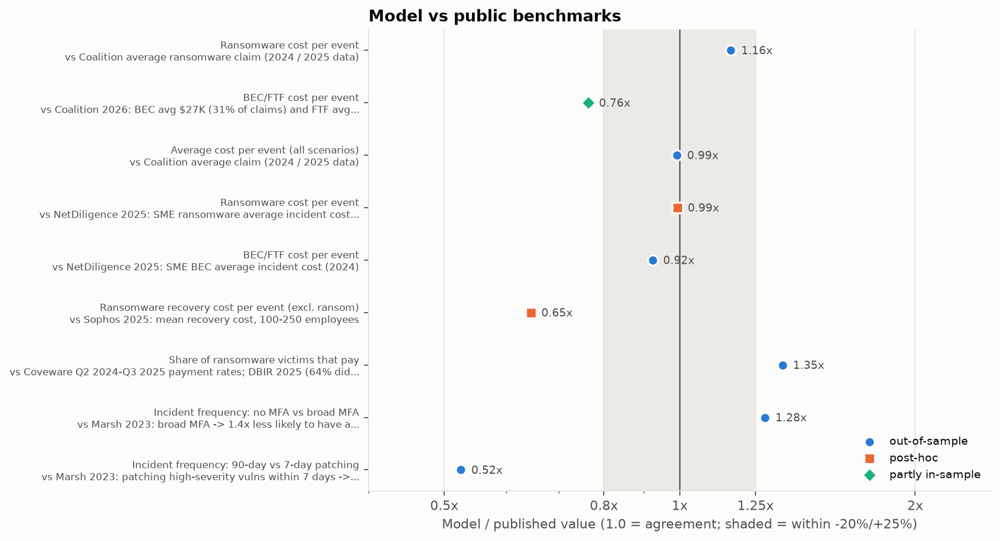
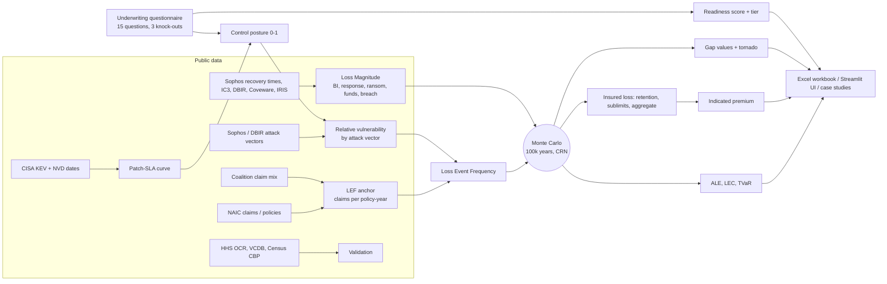

# cyber-risk-quant

[](https://github.com/AwpDemon/cyber-risk-quant/actions/workflows/ci.yml)

**What is a small business's cyber risk worth in dollars, and which missing control should it fix first to get insured and cut that risk?** This tool turns a cyber-insurance application's control questions (MFA, backups, EDR, patching...) into a FAIR-style Monte Carlo loss model. It outputs a readiness score, a ranked gap list with each fix's dollar value, and an underwriter-ready Excel workbook.

> **Data honesty, up front.** The three firms are **hypothetical** (no client data). Model inputs come from **public sources**: FBI IC3, NAIC, Verizon DBIR, Sophos, Coveware, Coalition, NetDiligence, Cyentia IRIS, Microsoft research, CISA KEV, NVD, HHS OCR, VCDB and Census CBP. Where no source exists, inputs are **labelled assumptions with ranges**. Of 80 parameters, 8 are taken directly from a source, 15 are derived from public data or published figures, and 57 are assumptions. Every one is listed with its basis in `config/parameters.yaml` and in each Excel workbook. The output is a decision aid, not a rate or a quote.

## Results

All numbers come from `crq report` (seed 20261010, 100,000 simulated years per posture). Two full runs produced identical output.

| Hypothetical firm | Readiness | ALE today (90% param. interval) | Fix knock-outs only | All controls best-practice | Top single fix by ALE |
|---|---|---|---|---|---|
| Dental clinic: 18 staff, $3.2M revenue, 9K patients | 21/100, **refer**: no MFA on email or remote access, backups reachable by attackers | **$2,720** ($1,086-$4,824) | $1,504 (-45%) | $419 (-85%) | EDR: -$1,148/yr |
| Law firm: 45 staff, $9.5M, trust account | 66/100, **refer**: backups only | **$1,569** ($553-$3,329) | $1,435 (-9%) | $703 (-55%) | Payment call-back: -$347/yr |
| Manufacturer: 140 staff, $38M, ERP/MES plant | 55/100, **refer**: vendor remote access without MFA | **$2,405** ($632-$5,349) | $1,899 (-21%) | $701 (-71%) | EDR: -$932/yr |

| Dental clinic | Current | Fix knock-outs | All controls |
|---|---|---|---|
| P(any loss event in a year) | 1.66% | 1.24% | 0.53% |
| P(annual loss > $100K) | 0.70% | 0.46% | 0.12% |
| TVaR99 (mean of the worst 1% of years) | $258K | $148K | $42K |
| Indicated premium (expected insured loss / 42% market loss ratio) | $5,704 | $3,077 | $829 |


**Findings worth discussing:**

1. **Knock-outs and expected loss are different questions.** For the dental clinic, the three knock-out fixes cost an illustrative ~$10K a year and cut expected loss by ~$1.2K. On ALE alone they don't pay, and only phishing training (1.03x) beats its own cost. Their value is insurability (whether the risk gets quoted at all) and the tail: TVaR99 falls from $258K, about 8% of revenue, to $148K.
2. **The best fix depends on the loss mix.** Ransomware is 75% of the clinic's expected loss and 85% of the manufacturer's, so EDR (which acts after entry on every route) leads. The law firm's largest component is BEC/wire fraud (41%), so a $500 payment call-back procedure is its best fix.
3. **Patching windows are shorter than most SLAs.** Of 832 CVEs published since 2022 that CISA lists as exploited, **27% were listed on or before their publication day, 50% within 7 days, 65% within 30** (CISA KEV + NVD, computed here).
4. **VaR95 is $0 for every firm**, because fewer than 5% of years have any loss. Rare-event risk needs exceedance probabilities and TVaR, which the tool reports instead.



### Validation (details in [docs/VALIDATION.md](docs/VALIDATION.md))

| Check | Model / published |
|---|---|
| Average cost per event vs Coalition average claim ($115K) | **0.99x** (out-of-sample) |
| Ransomware cost per event vs Coalition ($269K-$292K) | 1.16x (out-of-sample) |
| SME BEC cost vs NetDiligence ($75K) | 0.92x (out-of-sample) |
| SME ransomware cost vs NetDiligence (~$645K) | 0.99x (**post-hoc**: v1 was 5.4x too high; fixed with a size elasticity taken from Cyentia IRIS, not from NetDiligence) |
| MFA effect vs Marsh claims study (1.4x) | 1.76x vs 1.4x |
| Patching effect vs Marsh (~2x) | **1.03x vs 2x**: the largest disagreement; Marsh's figure is observational and confounded, and the model may undervalue patching |
| Dental reportable-breach rate vs HHS portal / Census establishments | **model ~26x higher**: under-reporting vs over-estimation cannot be separated with public data |



## How it works



* **FAIR decomposition:** risk = Loss Event Frequency x Loss Magnitude, both distributions. Frequency is anchored on insurance claims per policy-year (NAIC 2023-2024) split by Coalition's claim mix. It is then scaled by firm size, industry and **relative vulnerability**: each control reduces only the attack vectors it blocks (Sophos/DBIR initial-access shares), with effect sizes sampled from cited ranges.
* **Magnitude** is built from components: business interruption from a recovery-time curve fitted to Sophos survey data, response, restoration, ransom (pay probability tied to backup quality), BEC transfers (DBIR median + IC3 mean), and breach notification, regulatory and litigation costs.
* **Common random numbers** (inverse-CDF Poisson, per-event-slot random streams) make "fix one control" comparisons exact. The tests check that every simulated year is at least as cheap after any single improvement.
* **Two-dimensional Monte Carlo** separates parameter uncertainty (the 90% ALE interval) from year-to-year randomness.
* Full specification: [docs/METHODOLOGY.md](docs/METHODOLOGY.md). Teaching walkthrough: [docs/INTERVIEW_GUIDE.md](docs/INTERVIEW_GUIDE.md).

## Run it (5 commands)

```bash
python -m venv .venv && source .venv/bin/activate      # Windows: .venv\Scripts\activate
pip install -r requirements-dev.txt && pip install -e .
crq run profiles/dental_clinic.yaml --xlsx dental.xlsx  # ALE, tail metrics, gap list, underwriter workbook
streamlit run app/streamlit_app.py                       # interactive questionnaire + LEC
pytest                                                   # 40 tests
```

To rebuild everything from raw public data: `crq data download && crq calibrate && crq report` (about 7 minutes). Other commands: `crq assess <profile>` (score only), `crq validate`, `crq params` (every parameter with its source). Sample workbooks are in `examples/`. A read-only Docker setup for the UI is in `deploy/`.

## Repository map

| Path | What it is |
|---|---|
| `src/crq/model.py` | Monte Carlo engine: frequency, severity components, policy layer, CRN |
| `src/crq/controls.py` | Control posture, vector-based relative vulnerability, KEV patch curve |
| `src/crq/questionnaire.py`, `config/questionnaire.yaml` | Application-style questions, scoring, knock-outs, evidence checklist |
| `src/crq/calibration.py` | Fits from published statistics + dataset-derived tables (KEV, VCDB, HHS, CBP) |
| `src/crq/validation.py` | Benchmark checks and HHS comparison |
| `src/crq/analysis.py` | Gap analysis, control packages, tornado, 2-D uncertainty |
| `src/crq/excel.py` | Underwriter workbook (summary, gaps, evidence, LEC, assumptions, bibliography) |
| `config/parameters.yaml`, `config/sources.yaml` | Every parameter with basis + citations (test-enforced) |
| `profiles/` | The three hypothetical firms |
| `docs/case_studies/` | Generated case studies with analyst commentary |

## Data sources and licences

| Source | Used for | Licence / terms |
|---|---|---|
| CISA Known Exploited Vulnerabilities | KEV listing dates (patch curve) | U.S. Government work |
| NVD CVE API 2.0 | CVE publication dates | Public domain. *This product uses data from the NVD API but is not endorsed or certified by the NVD.* |
| HHS OCR Breach Portal | Dental breach counts and sizes (validation) | U.S. Government work |
| VERIS Community Database (VCDB) | Vector mix for small-victim breaches | CC BY-SA 4.0 ([vz-risk/VCDB](https://github.com/vz-risk/VCDB)); the derived table `data/processed/vcdb_small_victim_vectors.csv` is shared under the same licence |
| Census County Business Patterns 2022 | Dental/law/manufacturing establishment counts | U.S. Government work |
| Published reports (DBIR, IC3, Sophos, Coveware, Coalition, NetDiligence, IRIS, IBM, KnowBe4, Marsh, NAIC, Aon, CRI, At-Bay) | Individual statistics, quoted with attribution | Cited figures only; no report content redistributed. Full list: `config/sources.yaml` |

Raw data is downloaded by `crq data download` into `data/raw/` (git-ignored, about 200 MB). Only small derived tables are committed. HHS rows are committed without entity names.

## Limitations

* **No firm-level loss data.** No public dataset links an SMB's controls to its losses. Control effects come from vector shares times effect-size ranges, and are checked against Marsh's observational findings, not measured.
* **Frequency anchor.** Claims per policy-year mixes all insured sizes and claim types. The HHS comparison suggests it may overstate reportable breaches for small healthcare practices (~26x). A carrier would substitute its own class frequency.
* **Most parameters (57 of 80) are judgement.** They are ranges, and the tornado charts show which ones matter. Business-interruption assumptions and the frequency anchor dominate.
* **Single risk, independent scenarios.** No systemic/cloud aggregation, no contingent BI, no OT-specific modelling, U.S. regulatory context only.
* **Premium is a loss-cost indication.** Real premiums depend on filed rates, minimum premiums and the market cycle. No verified public SMB premium data was found to compare against.
* **Questionnaire weights** reflect underwriting emphasis in broker and carrier publications, not a fitted model.

## What I'd do next

1. Replace the frequency anchor with state attorney-general breach-portal data (it has denominators outside healthcare) to test the HHS gap more broadly.
2. Add an EPSS-weighted patch curve (prioritise by exploit probability, not only by SLA) and model edge devices separately, since KEV's top vendors are VPN and firewall makers.
3. Correlated scenarios (one intrusion leading to both ransomware and BEC) and a portfolio view (many SMBs, shared MSP or cloud dependency) for accumulation risk.
4. Bayesian updating of the control effects once any claims-with-attestations data is available.

## Author

Ali Askari. As an IT intern at a small IT services firm, I helped SMB clients gather control evidence (MFA status, backup posture, EDR coverage) for cyber-insurance renewal applications. This project is the quantitative version of that work, built entirely on public data and hypothetical firms. MIT licence.
