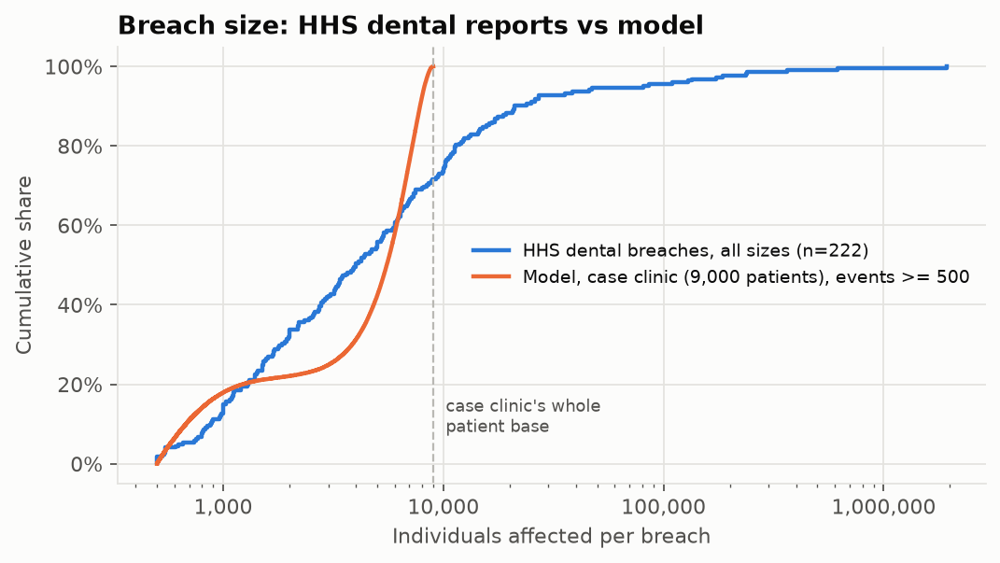
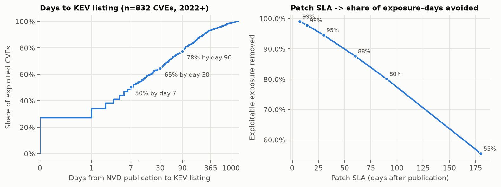

# Validation: what the model gets right, what it gets wrong, and what was changed

Reproduce everything here with `crq report` (or `crq validate` for the benchmark table). The numbers come from `docs/results/validation.json` (seed 7, 400,000 simulated years per check).

A cyber loss model for small businesses cannot be backtested the way a pricing model can: no public dataset links a firm's controls to its losses. What can be done honestly:

1. **Calibration checks.** Do the fitted distributions reproduce the published statistics they came from? (`tests/test_calibration.py`)
2. **Benchmark checks.** Simulate a firm that looks like a published study's population and compare. Each check is labelled:
   * **out-of-sample**: the benchmark number was not used to set any parameter.
   * **partly in-sample**: a related number from the same report informed a parameter.
   * **post-hoc**: the check failed in v1 and prompted a structural change (details below).
3. **Public-data checks.** Compare against independent records: the HHS breach portal and CISA KEV.

## 1. Benchmark checks

| Check | Benchmark firm (our sizing assumption) | Published | Model | Model / published | Label |
|---|---|---|---|---|---|
| Ransomware cost per event | Typical insured SMB: 25 staff, $5M revenue | Coalition average ransomware claim $292K (2024 data) / $269K (2025 data) | $326K | 1.16x | out-of-sample |
| Average cost per event, all scenarios | same | Coalition average claim $115K / $116K | $114K | 0.99x | out-of-sample |
| BEC/FTF cost per event | same | Coalition 2026 blend of BEC ($27K) and FTF ($141K): ~$80K | $60K | 0.76x | partly in-sample |
| Ransomware cost per event | NetDiligence average SME: 350 staff, $108M revenue | ~$630K-$660K | $640K | 0.99x | post-hoc |
| BEC/FTF cost per event | same | NetDiligence 2024 SME BEC average $75K | $68K | 0.92x | out-of-sample |
| Ransomware recovery cost excl. ransom | Sophos 100-250-employee respondent: 175 staff, $35M | $638,536 mean | $404K | 0.65x | post-hoc |
| Share of ransomware victims who pay | reference posture | Coveware 23%-36% by quarter (Coalition: 44% and 14%) | 38.9% | 1.35x vs Coveware midpoint | out-of-sample |
| P(at least one loss event / year) | 100 staff, $32M revenue | IRIS 2022 $10M-$100M upper bound 11.53% | 1.5% | below the bound | out-of-sample (weak: one-sided) |
| Incident frequency: no MFA vs broad MFA | reference SMB | Marsh 2023: 1.4x | 1.76x | 1.28x | out-of-sample |
| Incident frequency: 90-day vs 7-day patching | reference SMB | Marsh 2023: ~2x | 1.03x | 0.52x | out-of-sample |

**How to read this.**

* **Severity at small-business scale is well anchored.** The all-scenario average cost per event matches Coalition to within 1%, and ransomware is within 16%. Neither Coalition severity figure was an input.
* **Ransom-payment share runs high (39% vs 23-36% at Coveware).** It is within the full published range (Coalition 14%-44%). The model assumes a typical insured SMB's backups are only 60% of best practice. Payment rates have been falling fast, so this probably overstates 2026 payment behaviour.
* **MFA effect: the model says 1.76x, Marsh observed 1.4x.** Marsh compares "broad MFA" with "not broad", and many firms in the second group have partial MFA. The model compares no MFA at all with full coverage, so a bigger ratio is expected. The direction and order of magnitude agree.
* **Patching effect: the model says 1.03x, Marsh observed ~2x. This is the biggest disagreement.** Two reasons, and both are worth saying in an interview:
  1. In the model, patching only acts on the exploit route. For SMBs, frequency is dominated by BEC, which patching does not touch. Marsh's clients are larger firms, where intrusion-based events weigh more.
  2. Marsh's comparison is observational. Firms that patch within 7 days (only 24% of their sample) are better run in every respect, so the 2x mixes patching with everything else they do well. The model holds everything else fixed.

  The model is probably somewhat low and Marsh's 2x is certainly confounded. The truth is in between, and this is listed as a limitation.

## 2. The v1 failure and the v2 change (post-hoc label)

The first version scaled business interruption linearly with revenue and restoration linearly with endpoint count. Against mid-size benchmarks it failed badly:

| Check | v1 model | Published | v1 ratio |
|---|---|---|---|
| NetDiligence SME ransomware cost per event ($108M revenue) | $3.48M | ~$645K | 5.4x |
| Sophos 100-250 employees, recovery cost excl. ransom | $1.26M | $639K | 2.0x |

**Diagnosis.** Breaking cost into components showed business interruption was 75% of the mid-size number. Sophos's heavy-tailed *full*-recovery time was being multiplied by a daily revenue that grows 1:1 with firm size. In reality, larger firms have redundancy, in-house IT and partial operations, and restore revenue-critical systems first.

**Change.** Size-driven components now scale as `(size / reference size)^(gamma - 1)`, i.e. loss grows with size^gamma. Gamma was **not** fitted to NetDiligence or Sophos. It is the slope of log(loss) on log(revenue) across Cyentia IRIS 2025 revenue tiers: 0.25 for medians and 0.43 for 95th percentiles, with 0.19 from IRIS 2022. The model uses PERT(0.15, 0.25, 0.45).

**After the change:** NetDiligence 0.99x, Sophos 0.65x, and the small-firm Coalition checks were essentially unchanged. The change was prompted by these two benchmarks, so they are labelled post-hoc and should count as weaker evidence than the out-of-sample rows.

## 3. HHS breach portal: a frequency gap the model cannot close

Covered entities must report breaches affecting 500 or more people to HHS. The comparison:

* **Observed:** dental-practice breaches on the portal (name-matched; 222 since 2010), 2020-2025 average **18.2 per year**. Census County Business Patterns 2022 counts **136,140** dental offices. That gives an observed reportable rate of **0.013% per office per year**.
* **Name-matching recall:** of 146 portal entries whose description mentions dentistry, 124 (85%) are caught by the name pattern, and most misses aren't dental practices. Undercounting by name does not explain the gap below.
* **Model:** for an average-size dental office (7.6 employees, CBP) at the reference control posture, the rate of reportable events (ransomware on PHI systems, or a breach exposing 500+ patients) is **0.35% per year, about 26x the observed rate**. For the case-study clinic with its weak controls it is about 53x.

Explanations the public data cannot separate:

1. **Under-reporting.** Small practices hit by ransomware may never report, or may conclude after forensics that PHI was not accessed.
2. **Claims are not breaches.** The frequency anchor is insurance claims (NAIC), which include incidents that never become reportable 500+ record breaches.
3. **Dental offices may be hit less often than the average insured SMB** that the claims data describes.

**Consequence for users.** For healthcare practices, read the absolute ALE as an upper-range estimate. The *ranking* of control fixes depends on relative vulnerability, not on the frequency anchor, so it is unaffected. A carrier would replace the anchor with its own claim frequency for the class.

**Breach size.** HHS dental breaches have median 4,007 individuals (P75 10,168, P90 20,998; multi-site groups included). The model's breach sizes for the 9,000-patient case clinic (events with 500+ records) have median 5,533, capped at the clinic's patient base. Restricted to HHS breaches no larger than 9,000 people, the HHS median is 2,349. So the model puts too much weight on "most of the database" breaches. That is a conservative bias (more notification cost), noted as a limitation.

## 4. CISA KEV / NVD: the patch-cadence input

Of the 832 CVEs published since January 2022 that are now in CISA's Known Exploited Vulnerabilities catalog, **27.2% were added to KEV on or before their NVD publication day**. **50.5% were added within 7 days, 64.5% within 30 and 77.5% within 90.** 18.75% are flagged for known ransomware use. This is a direct, reproducible measurement, and it is why the readiness questionnaire scores a 30-day patch SLA well below a 7-day one.

## 5. What would make validation stronger

* Carrier or broker claims data with control attestations: the Marsh-style analysis, on SMBs, with the controls this questionnaire asks about.
* A second public breach source with denominators (state attorney-general breach portals, e.g. Maine or Washington) to test the HHS gap outside healthcare.
* Temporal holdout: fit to 2023 claims statistics and predict the 2025 reports, once a consistent series of three or more years is available.
