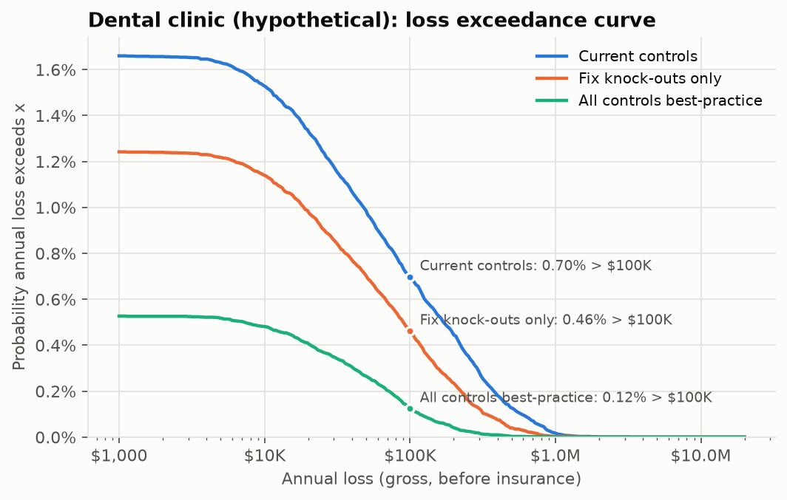
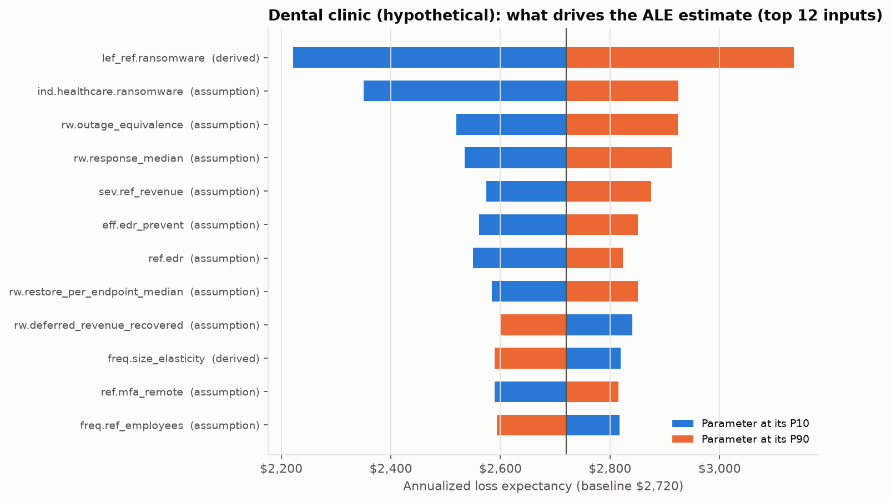

# Case study: Dental clinic (hypothetical)

> **Hypothetical firm.** Not a real business and not built from any client's data. Every number below is model output from `crq report` (seed 20261010) using public data and the stated assumptions in `config/parameters.yaml`.

Three-dentist general practice, one location. Practice-management and imaging software on a local server; the software vendor supports it over remote desktop.

| Profile | |
|---|---|
| Employees / endpoints | 18 / 24 |
| Annual revenue | $3.2M |
| Records held | 9,000 |
| Policy | $1.0M aggregate, $10K retention, $100K social-engineering sublimit |

## Underwriting readiness

**Score 21/100, tier: Refer / restricted.** Knock-out gaps: `mfa_email`, `mfa_remote`, `backups`.

| Control | Current answer |
|---|---|
| mfa_email | Partly - some users, or MFA optional |
| mfa_remote | No MFA on remote access, or RDP open to the internet |
| mfa_privileged | No |
| edr | Traditional antivirus only |
| backups | Off-site / cloud copy reachable with normal admin credentials |
| patching | Within 90 days |
| eol_systems | Yes, but isolated / segmented with compensating controls |
| email_security | Built-in basic spam filtering only |
| training | No |
| payment_verification | Informally / sometimes |
| ir_plan | No |
| asset_inventory | Partial / manual |
| encryption | Some devices |
| vendor_access | No / unknown |
| logging | No / unknown |

## Quantified risk (100,000 simulated years per posture)

| Metric | Current | Fix knock-outs only | All controls best-practice |
|---|---|---|---|
| Readiness score / tier | 21 / Refer / restricted | 48 / Conditional | 100 / Preferred |
| Annualized loss expectancy (ALE) | $2,720 | $1,504 | $419 |
| Monte Carlo standard error of ALE | $115 | $71 | $29 |
| P(any loss event in a year) | 1.66% | 1.24% | 0.53% |
| P(annual loss > $100K) | 0.70% | 0.46% | 0.12% |
| P(annual loss > $1M) | 0.017% | 0.003% | 0.001% |
| TVaR 99% (mean of worst 1% of years) | $258K | $148K | $42K |
| Expected insured loss | $2,396 | $1,292 | $348 |
| Indicated premium (loss-cost view) | $5,704 | $3,077 | $829 |

ALE 90% interval from parameter uncertainty alone (two-dimensional Monte Carlo, 400 parameter draws x 1,000 years): **$1,086 to $4,824**.

Why no 95th percentile? Fewer than 5% of simulated years contain any loss, so the 95th-percentile annual loss is $0. Tail risk is reported as exceedance probabilities and TVaR instead.

### Expected loss by scenario (current controls)

| Scenario | Events / year | ALE | Share |
|---|---|---|---|
| Ransomware / extortion | 0.0057 | $2,029 | 75% |
| BEC / funds transfer fraud | 0.0072 | $406 | 15% |
| Data breach (non-ransomware) | 0.0041 | $285 | 10% |

## Gap list: what each fix is worth on its own

One control changed at a time, same random numbers (common random numbers), so the differences are not sampling noise (the shared noise cancels; every simulated year is at least as cheap after a fix, which the test-suite checks). The rows do not add up to the package results above, because controls overlap (MFA and EDR both stop some of the same intrusions).

| Control | Knock-out | Recommended | ALE reduction | TVaR99 reduction | Indicated premium change | Illustrative annual cost | Evidence strength |
|---|---|---|---|---|---|---|---|
| mfa_remote | **yes** | Yes - MFA on all remote access and no exposed RDP | $555 | $49K | -22.4% | $2,648 | strong |
| backups | **yes** | Immutable or offline copy, separate credentials, full restore tested in the last 12 months | $513 | $51K | -20.6% | $6,000 | strong |
| mfa_email | **yes** | Yes - enforced for all users (conditional access / security defaults) | $264 | $19K | -8.8% | $1,500 | strong |
| edr |  | 100% coverage, monitored 24/7 (MDR / SOC) | $1,148 | $105K | -45.0% | $3,456 | moderate |
| mfa_privileged |  | Yes - all privileged accounts, separate admin accounts | $603 | $54K | -24.4% | $1,500 | moderate |
| email_security |  | Yes - advanced filtering and DMARC p=quarantine/reject | $464 | $39K | -17.9% | $1,148 | moderate |
| training |  | Yes - at least quarterly, with phishing simulations | $443 | $37K | -16.9% | $432 | weak |
| ir_plan |  | Yes - written and tested in the last 12 months | $243 | $24K | -9.3% | $5,000 | moderate |
| payment_verification |  | Yes - documented, enforced, dual approval above a threshold | $211 | $11K | -5.1% | $500 | weak |
| patching |  | Within 7 days | $152 | $13K | -6.1% | $2,864 | moderate |
| eol_systems |  | No | $70 | $6,065 | -2.8% | $5,000 | moderate |
| asset_inventory |  | Yes, automated and current | n/a | n/a | qualitative only | $1,000 | weak |
| encryption |  | Yes, enforced by policy | n/a | n/a | qualitative only | $1,000 | moderate |
| vendor_access |  | Yes | n/a | n/a | qualitative only | $1,000 | moderate |
| logging |  | Yes | n/a | n/a | qualitative only | $1,000 | weak |

Indicated premium change = change in expected insured loss (loss-cost view). In the market, knock-out gaps matter far more than this percentage suggests: they decide whether the risk is quoted at all, and whether ransomware is sublimited. Small accounts also often sit at a carrier's minimum premium, so a lower technical price may not show up on the invoice.

## What drives the estimate

| Input | Basis | ALE at P10 | ALE at P90 |
|---|---|---|---|
| `lef_ref.ransomware` - Ransomware/extortion claims per policy-year for the reference insured SMB | derived | $2,222 | $3,135 |
| `ind.healthcare.ransomware` - Healthcare ransomware frequency multiplier | assumption | $2,350 | $2,925 |
| `rw.outage_equivalence` - Average share of normal operations lost across the recovery period | assumption | $2,520 | $2,924 |
| `rw.response_median` - Median incident response cost per ransomware event (forensics, breach coach, negotiation) | assumption | $2,534 | $2,913 |
| `sev.ref_revenue` - Annual revenue of the reference insured SMB at which size-driven severity is linear | assumption | $2,575 | $2,875 |
| `eff.edr_prevent` - Share of intrusions stopped before ransomware deployment by monitored EDR | assumption | $2,561 | $2,851 |
| `ref.edr` - Reference EDR coverage | assumption | $2,550 | $2,824 |
| `rw.restore_per_endpoint_median` - Median restoration cost per endpoint (rebuild labour, overtime, replacement) | assumption | $2,585 | $2,851 |

## Analyst commentary

**Underwriter's read.** Three knock-outs (MFA on email, MFA on remote access, an offline or immutable backup) put this
practice in the refer/restricted tier. As submitted, most carriers would decline it, or require fixes before binding or add a
ransomware sublimit. The vendor's remote-desktop access to the practice server is the single most typical finding in a
small-practice renewal.

**What the numbers say.**
- Ransomware is 75% of the expected loss. The clinic runs on one server, depends heavily on it (85% of revenue stops),
  and has no offline backup, so a ransomware event drives long downtime and a high chance of paying.
- Fixing only the three knock-outs cuts ALE from $2,720 to $1,504 and the indicated premium from $5,704 to $3,077. It
  also lowers P(annual loss > $100K) from 0.70% to 0.46% and the worst-1%-of-years average (TVaR99) from $258K to $148K.
- The best single fix by expected loss is EDR ($1,148/yr), not a knock-out. EDR acts after entry on every ransomware route,
  while each MFA control blocks one route.

**The honest ROI point.** The three knock-out fixes cost an illustrative ~$10K a year and reduce ALE by ~$1.2K. On expected
loss alone they don't pay for themselves. Phishing training is the only fix here whose ALE reduction exceeds its cost
(1.03x). The real case for the knock-outs is different. They decide whether the practice can buy cover at all and on
what terms. They also cut the tail: a TVaR99 of $258K is about 8% of revenue, a hit that would be survivable only if insured.

**Caveat specific to this case.** The claims-anchored frequency implies ~26x more HIPAA-reportable incidents for an
average dental office than appear on the HHS breach portal (see docs/VALIDATION.md). If the HHS count is closer to the truth
for dental practices, this ALE is too high. The ranking of fixes would not change, because it depends on relative
vulnerability rather than on the frequency anchor.
