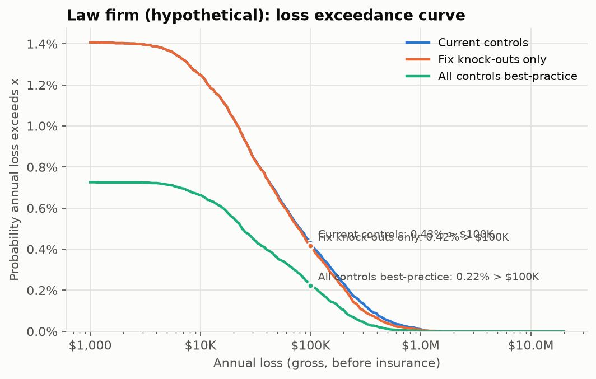
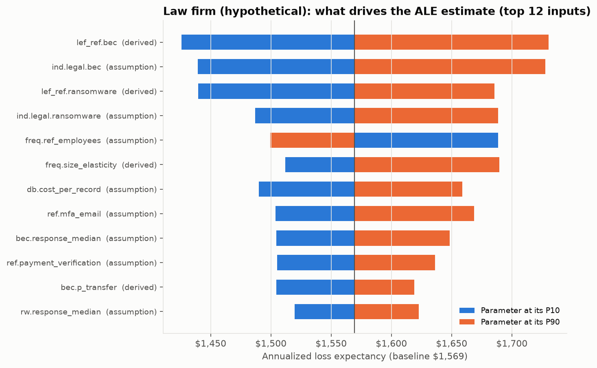

# Case study: Law firm (hypothetical)

> **Hypothetical firm.** Not a real business and not built from any client's data. Every number below is model output from `crq report` (seed 20261010) using public data and the stated assumptions in `config/parameters.yaml`.

20-attorney firm (real estate, estate planning, litigation). Microsoft 365, cloud practice management, trust account used for real-estate closings.

| Profile | |
|---|---|
| Employees / endpoints | 45 / 60 |
| Annual revenue | $9.5M |
| Records held | 30,000 |
| Policy | $2.0M aggregate, $25K retention, $250K social-engineering sublimit |

## Underwriting readiness

**Score 66/100, tier: Refer / restricted.** Knock-out gaps: `backups`.

| Control | Current answer |
|---|---|
| mfa_email | Yes - enforced for all users (conditional access / security defaults) |
| mfa_remote | Yes - MFA on all remote access and no exposed RDP |
| mfa_privileged | Some privileged accounts / shared admin logins remain |
| edr | >=90% coverage, alerts reviewed in business hours |
| backups | Off-site / cloud copy reachable with normal admin credentials |
| patching | Within 30 days |
| eol_systems | No |
| email_security | One of the two (or DMARC at p=none) |
| training | Annual training only |
| payment_verification | Informally / sometimes |
| ir_plan | Written but not tested |
| asset_inventory | Partial / manual |
| encryption | Yes, enforced by policy |
| vendor_access | Partly |
| logging | Yes |

## Quantified risk (100,000 simulated years per posture)

| Metric | Current | Fix knock-outs only | All controls best-practice |
|---|---|---|---|
| Readiness score / tier | 66 / Refer / restricted | 74 / Standard | 100 / Preferred |
| Annualized loss expectancy (ALE) | $1,569 | $1,435 | $703 |
| Monte Carlo standard error of ALE | $76 | $68 | $42 |
| P(any loss event in a year) | 1.41% | 1.41% | 0.73% |
| P(annual loss > $100K) | 0.43% | 0.42% | 0.22% |
| P(annual loss > $1M) | 0.010% | 0.005% | 0.000% |
| TVaR 99% (mean of worst 1% of years) | $152K | $139K | $70K |
| Expected insured loss | $1,150 | $1,015 | $504 |
| Indicated premium (loss-cost view) | $2,737 | $2,417 | $1,201 |

ALE 90% interval from parameter uncertainty alone (two-dimensional Monte Carlo, 400 parameter draws x 1,000 years): **$553 to $3,329**.

Why no 95th percentile? Fewer than 5% of simulated years contain any loss, so the 95th-percentile annual loss is $0. Tail risk is reported as exceedance probabilities and TVaR instead.

### Expected loss by scenario (current controls)

| Scenario | Events / year | ALE | Share |
|---|---|---|---|
| Ransomware / extortion | 0.0019 | $632 | 40% |
| BEC / funds transfer fraud | 0.0093 | $646 | 41% |
| Data breach (non-ransomware) | 0.0030 | $291 | 19% |

## Gap list: what each fix is worth on its own

One control changed at a time, same random numbers (common random numbers), so the differences are not sampling noise (the shared noise cancels; every simulated year is at least as cheap after a fix, which the test-suite checks). The rows do not add up to the package results above, because controls overlap (MFA and EDR both stop some of the same intrusions).

| Control | Knock-out | Recommended | ALE reduction | TVaR99 reduction | Indicated premium change | Illustrative annual cost | Evidence strength |
|---|---|---|---|---|---|---|---|
| backups | **yes** | Immutable or offline copy, separate credentials, full restore tested in the last 12 months | $135 | $13K | -11.7% | $6,000 | strong |
| payment_verification |  | Yes - documented, enforced, dual approval above a threshold | $347 | $30K | -15.6% | $500 | weak |
| email_security |  | Yes - advanced filtering and DMARC p=quarantine/reject | $151 | $13K | -9.3% | $2,120 | moderate |
| training |  | Yes - at least quarterly, with phishing simulations | $150 | $13K | -9.1% | $1,080 | weak |
| edr |  | 100% coverage, monitored 24/7 (MDR / SOC) | $101 | $9,592 | -8.3% | $8,640 | moderate |
| mfa_privileged |  | Yes - all privileged accounts, separate admin accounts | $55 | $5,093 | -4.4% | $1,500 | moderate |
| ir_plan |  | Yes - written and tested in the last 12 months | $43 | $4,222 | -3.6% | $5,000 | moderate |
| patching |  | Within 7 days | $8 | $669 | -0.6% | $4,160 | moderate |
| asset_inventory |  | Yes, automated and current | n/a | n/a | qualitative only | $1,000 | weak |
| vendor_access |  | Yes | n/a | n/a | qualitative only | $1,000 | moderate |

Indicated premium change = change in expected insured loss (loss-cost view). In the market, knock-out gaps matter far more than this percentage suggests: they decide whether the risk is quoted at all, and whether ransomware is sublimited. Small accounts also often sit at a carrier's minimum premium, so a lower technical price may not show up on the invoice.

## What drives the estimate

| Input | Basis | ALE at P10 | ALE at P90 |
|---|---|---|---|
| `lef_ref.bec` - BEC / funds-transfer-fraud claims per policy-year for the reference insured SMB | derived | $1,426 | $1,730 |
| `ind.legal.bec` - Legal BEC frequency multiplier | assumption | $1,439 | $1,728 |
| `lef_ref.ransomware` - Ransomware/extortion claims per policy-year for the reference insured SMB | derived | $1,440 | $1,686 |
| `ind.legal.ransomware` - Legal ransomware frequency multiplier | assumption | $1,487 | $1,688 |
| `freq.ref_employees` - Headcount of the 'reference' insured SMB the claim frequencies describe | assumption | $1,689 | $1,499 |
| `freq.size_elasticity` - Elasticity of event frequency to firm size (frequency proportional to size^beta) | derived | $1,512 | $1,690 |
| `db.cost_per_record` - Notification + call-centre cost per affected person | assumption | $1,490 | $1,659 |
| `ref.mfa_email` - Reference MFA-on-email level | assumption | $1,504 | $1,669 |

## Analyst commentary

**Underwriter's read.** A mostly mature firm (MFA everywhere, EDR, a written IR plan) held back by one knock-out: the cloud
backup can be reached and deleted with normal admin credentials. Sophos found attackers try to compromise backups in 94%
of attacks. Fixing it moves the firm from refer/restricted to Standard (score 66 -> 74).

**What the numbers say.**
- BEC/funds-transfer fraud is the largest single component of expected loss (41%, about equal to ransomware). That is
  what you would expect for a firm that moves client money through a trust account for real-estate closings.
- The best fix by expected loss and by cost-efficiency is a documented call-back and dual-approval procedure for payment
  changes: $347/yr ALE reduction and a 15.6% lower indicated premium for an illustrative $500 process change. The evidence
  behind its effect size is the weakest in the model (labelled "weak"), so the number is an argument for the control,
  not a measurement of it.
- Faster patching (30 -> 7 days) is worth almost nothing here ($8/yr). The firm already patches in 30 days, and the
  exploit route is a small part of a BEC-heavy risk.

**Policy structure matters as much as controls.** The $250K social-engineering sublimit caps what the policy pays on a
fraudulent wire. A real-estate closing wire can exceed that, so part of the BEC tail stays with the firm whatever its controls.
