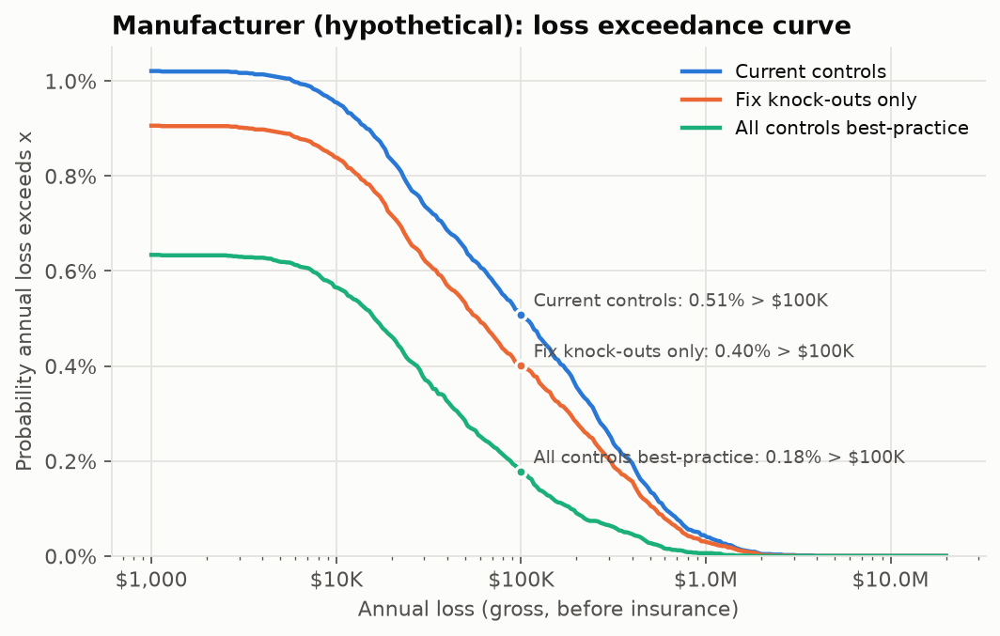
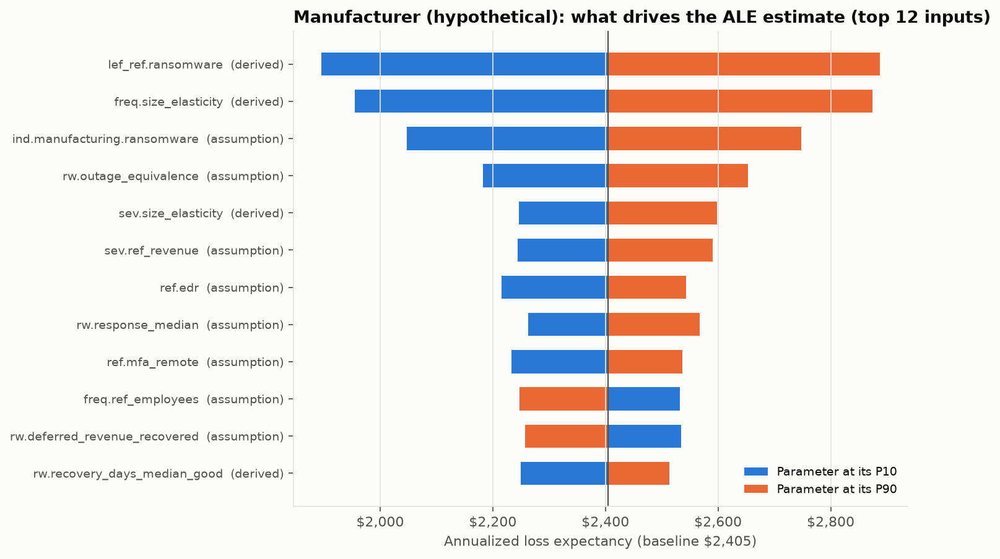

# Case study: Manufacturer (hypothetical)

> **Hypothetical firm.** Not a real business and not built from any client's data. Every number below is model output from `crq report` (seed 20261010) using public data and the stated assumptions in `config/parameters.yaml`.

Precision-parts manufacturer, one plant. ERP and MES on-prem; machine vendors reach plant HMIs through a remote-support tool.

| Profile | |
|---|---|
| Employees / endpoints | 140 / 160 |
| Annual revenue | $38.0M |
| Records held | 1,500 |
| Policy | $3.0M aggregate, $50K retention, $250K social-engineering sublimit |

## Underwriting readiness

**Score 55/100, tier: Refer / restricted.** Knock-out gaps: `mfa_remote`.

| Control | Current answer |
|---|---|
| mfa_email | Yes - enforced for all users (conditional access / security defaults) |
| mfa_remote | MFA on VPN, but some remote tools or accounts without MFA |
| mfa_privileged | Some privileged accounts / shared admin logins remain |
| edr | 50-90% coverage, or not actively monitored |
| backups | Immutable or offline copy, but restore not tested in 12 months |
| patching | Within 30 days |
| eol_systems | Yes |
| email_security | Yes - advanced filtering and DMARC p=quarantine/reject |
| training | Annual training only |
| payment_verification | Yes - documented, enforced, dual approval above a threshold |
| ir_plan | No |
| asset_inventory | Partial / manual |
| encryption | Some devices |
| vendor_access | No / unknown |
| logging | No / unknown |

## Quantified risk (100,000 simulated years per posture)

| Metric | Current | Fix knock-outs only | All controls best-practice |
|---|---|---|---|
| Readiness score / tier | 55 / Refer / restricted | 64 / Conditional | 100 / Preferred |
| Annualized loss expectancy (ALE) | $2,405 | $1,899 | $701 |
| Monte Carlo standard error of ALE | $136 | $116 | $55 |
| P(any loss event in a year) | 1.02% | 0.91% | 0.63% |
| P(annual loss > $100K) | 0.51% | 0.40% | 0.18% |
| P(annual loss > $1M) | 0.042% | 0.030% | 0.006% |
| TVaR 99% (mean of worst 1% of years) | $240K | $190K | $70K |
| Expected insured loss | $1,938 | $1,499 | $434 |
| Indicated premium (loss-cost view) | $4,615 | $3,569 | $1,033 |

ALE 90% interval from parameter uncertainty alone (two-dimensional Monte Carlo, 400 parameter draws x 1,000 years): **$632 to $5,349**.

Why no 95th percentile? Fewer than 5% of simulated years contain any loss, so the 95th-percentile annual loss is $0. Tail risk is reported as exceedance probabilities and TVaR instead.

### Expected loss by scenario (current controls)

| Scenario | Events / year | ALE | Share |
|---|---|---|---|
| Ransomware / extortion | 0.0047 | $2,054 | 85% |
| BEC / funds transfer fraud | 0.0035 | $257 | 11% |
| Data breach (non-ransomware) | 0.0020 | $94 | 4% |

## Gap list: what each fix is worth on its own

One control changed at a time, same random numbers (common random numbers), so the differences are not sampling noise (the shared noise cancels; every simulated year is at least as cheap after a fix, which the test-suite checks). The rows do not add up to the package results above, because controls overlap (MFA and EDR both stop some of the same intrusions).

| Control | Knock-out | Recommended | ALE reduction | TVaR99 reduction | Indicated premium change | Illustrative annual cost | Evidence strength |
|---|---|---|---|---|---|---|---|
| mfa_remote | **yes** | Yes - MFA on all remote access and no exposed RDP | $506 | $51K | -22.7% | $7,040 | strong |
| edr |  | 100% coverage, monitored 24/7 (MDR / SOC) | $932 | $93K | -43.0% | $23K | moderate |
| mfa_privileged |  | Yes - all privileged accounts, separate admin accounts | $389 | $39K | -17.4% | $1,500 | moderate |
| eol_systems |  | No | $364 | $36K | -16.0% | $5,000 | moderate |
| backups |  | Immutable or offline copy, separate credentials, full restore tested in the last 12 months | $324 | $32K | -16.7% | $6,000 | strong |
| training |  | Yes - at least quarterly, with phishing simulations | $319 | $32K | -13.7% | $3,360 | weak |
| ir_plan |  | Yes - written and tested in the last 12 months | $226 | $23K | -11.3% | $5,000 | moderate |
| patching |  | Within 7 days | $62 | $6,111 | -2.9% | $7,760 | moderate |
| asset_inventory |  | Yes, automated and current | n/a | n/a | qualitative only | $1,000 | weak |
| encryption |  | Yes, enforced by policy | n/a | n/a | qualitative only | $1,000 | moderate |
| vendor_access |  | Yes | n/a | n/a | qualitative only | $1,000 | moderate |
| logging |  | Yes | n/a | n/a | qualitative only | $1,000 | weak |

Indicated premium change = change in expected insured loss (loss-cost view). In the market, knock-out gaps matter far more than this percentage suggests: they decide whether the risk is quoted at all, and whether ransomware is sublimited. Small accounts also often sit at a carrier's minimum premium, so a lower technical price may not show up on the invoice.

## What drives the estimate

| Input | Basis | ALE at P10 | ALE at P90 |
|---|---|---|---|
| `lef_ref.ransomware` - Ransomware/extortion claims per policy-year for the reference insured SMB | derived | $1,895 | $2,887 |
| `freq.size_elasticity` - Elasticity of event frequency to firm size (frequency proportional to size^beta) | derived | $1,955 | $2,874 |
| `ind.manufacturing.ransomware` - Manufacturing ransomware frequency multiplier | assumption | $2,047 | $2,748 |
| `rw.outage_equivalence` - Average share of normal operations lost across the recovery period | assumption | $2,182 | $2,653 |
| `sev.size_elasticity` - Elasticity of size-driven loss (business interruption, restoration) to firm size | derived | $2,246 | $2,598 |
| `sev.ref_revenue` - Annual revenue of the reference insured SMB at which size-driven severity is linear | assumption | $2,244 | $2,591 |
| `ref.edr` - Reference EDR coverage | assumption | $2,216 | $2,543 |
| `rw.response_median` - Median incident response cost per ransomware event (forensics, breach coach, negotiation) | assumption | $2,262 | $2,567 |

## Analyst commentary

**Underwriter's read.** Good email and payment controls and an immutable (but untested) backup. The knock-out is remote
access: machine vendors reach plant HMIs through a remote-support tool without MFA. Coveware's 2025 data puts
remote-access compromise behind more than half of ransomware incidents. End-of-life Windows on plant HMIs is the second
finding an underwriter will circle.

**What the numbers say.**
- Ransomware is 85% of expected loss. With ERP/MES running production, downtime is the loss.
- This firm has the fattest tail of the three: P(annual loss > $1M) is 0.042%, against 0.017% for the dental clinic.
- EDR is again the largest single fix ($932/yr), but at ~$23K/yr for 160 endpoints it has the lowest return per dollar
  (0.04). MFA/PAM on admin accounts gives $389/yr for ~$1.5K and is the most cost-efficient fix here.
- The tornado chart shows the estimate is most sensitive to the size elasticities of frequency and severity. The model is
  extrapolating from small-business claims data to a 140-person firm, and those two parameters carry that extrapolation.
  Real underwriting of an account this size would lean on the carrier's own mid-market loss data.

**Not modelled.** Operational technology (PLCs, HMIs) as a separate attack surface, and contingent business interruption
from a key supplier's outage. Both matter for manufacturers.
